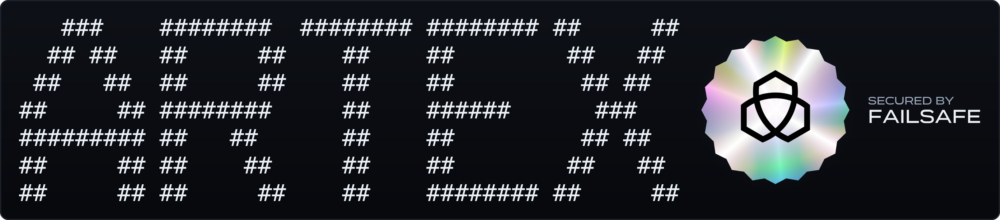
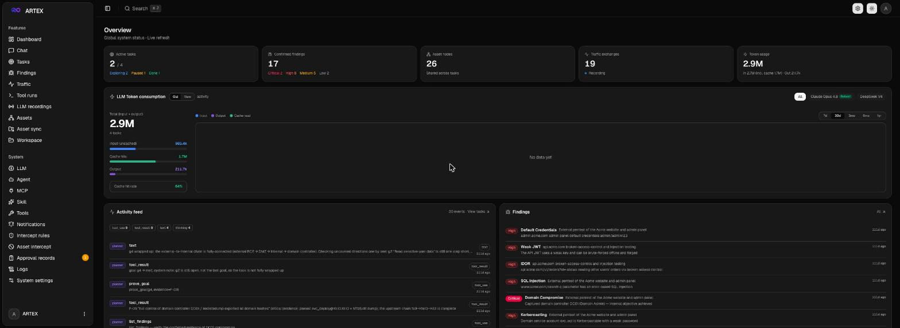
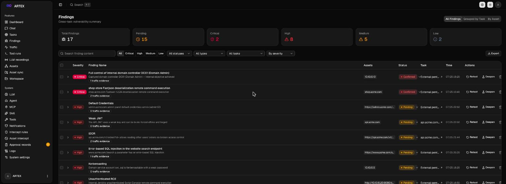
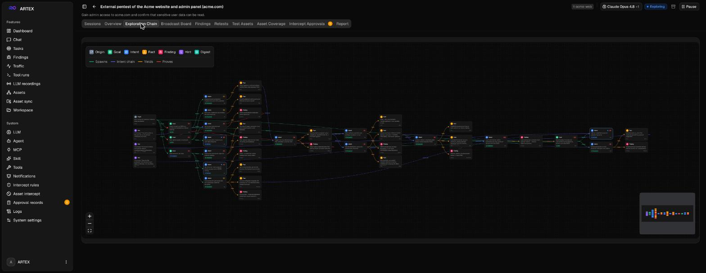
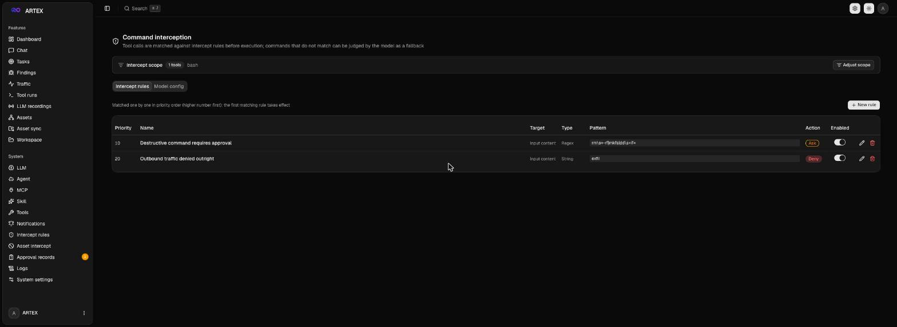
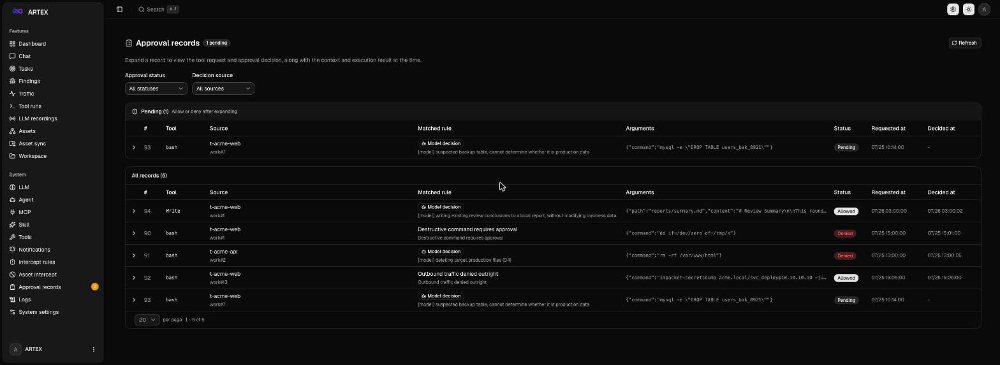

# Translated FailSafe ARTEX

<p align="center">
  
</p>

**English (fully translated) build of ARTEX.** This repository is a fully English-language distribution of ARTEX. It is based on the **FailSafe ARTEX** fork ([`failsafe-security/artex`](https://github.com/failsafe-security/artex)) — a source-built, hardened, localhost-bound distribution compiled from the audited `v0.3.15` tag — which is itself derived from the upstream open-source project **ARTEX** ([`RuoJi6/ARTEX`](https://github.com/RuoJi6/ARTEX), original authors Autumn-27 and the ARTEX contributors). Full credit for the framework and for the hardened, de-backdoored fork goes to those projects; this build only adds a language layer on top of their work. **What this build changes:** every Chinese (Han) string has been translated to English and removed from the runtime — the Go application, all agent system prompts, the entire Next.js web console, API/error/notification strings, and the database-seeded content (tool descriptions, agent prompts, and the default intercept/asset rules) — plus the two vendored Chinese-authored dependencies, the `norma` agent SDK and `go-mitmproxy`, which are translated and pinned via local `replace` directives (see `third_party/`). A mandatory English-output directive is appended to every agent prompt so the LLM emits English only, regardless of which model backs it. The build otherwise preserves FailSafe's hardening and the exact runtime configuration in use (OpenRouter-compatible LLM endpoint; localhost/LAN console binding). Functional Chinese-language matchers (e.g. ICP/GBK handling) are preserved as code so target handling is unaffected.

A source-built, locally bound distribution of [ARTEX](https://github.com/RuoJi6/ARTEX),
an open-source multi-agent security testing harness.

This repository exists because the prebuilt `tomicdd/artex` Docker image was
found to contain an unauthenticated command-execution backdoor in November 2026.
This build is compiled from the audited `v0.3.15` source tag and keeps upstream's
full runtime capabilities, including Node 22, Playwright, Chromium, and nmap.
The compose file binds the console to localhost and does not publish the
recording proxy.

> **Authorized testing only.** ARTEX runs an autonomous agent that can execute
> shell commands and send network traffic. Use it only against systems you own
> or have explicit written permission to test.

## Screenshots

**Dashboard** — global status: active tasks, confirmed findings by severity, shared assets, and LLM token usage.



**Findings** — the cross-task vulnerability summary; each finding carries a severity, the affected assets, a status, and linked traffic evidence.



**Exploration chain (attack graph)** — the attack path as a graph of origins, goals, intents, facts, and findings, with edges showing how each step derives from the last.



**Command interception** — every agent tool call is matched against intercept rules before it runs; a command that matches no rule can be judged by the model as a fallback.



**Approval records** — an audit trail of each intercepted tool call: its matched rule or model decision, the exact arguments, and the allow / deny / pending outcome.



## Quick start

Requirements: Docker Engine with Compose v2, and about 5 GB of free disk
(the browser stack and Chromium account for most of the image size).
If your Docker installation only provides the standalone `docker-compose`
command, substitute it for `docker compose` below; `make` detects either.

```bash
cp .env.safe.example .env.safe
chmod 600 .env.safe
# edit .env.safe: set POSTGRES_PASSWORD and, optionally, an LLM key
docker compose --env-file .env.safe -f docker-compose.safe.yml up -d --build
```

Open <http://127.0.0.1:8787> and complete the first-run setup. If you left the
LLM key blank, configure a provider in the console before starting a scan.

Check status and logs:

```bash
docker compose --env-file .env.safe -f docker-compose.safe.yml ps
docker compose --env-file .env.safe -f docker-compose.safe.yml logs -f artex
```

Stop without deleting data:

```bash
docker compose --env-file .env.safe -f docker-compose.safe.yml down
```

Delete everything, including the database and ARTEX data:

```bash
docker compose --env-file .env.safe -f docker-compose.safe.yml down -v
```

## What is different from upstream

| Area | Upstream default | This build |
|---|---|---|
| Image | prebuilt `tomicdd/artex` (backdoored) | compiled from this source tree |
| Runtime user | root | root (upstream parity) |
| Console binding | `0.0.0.0:8787` | `127.0.0.1:8787` |
| Recording proxy | published on `8788` | not published |
| Browser automation | Node 22 + Playwright + Chromium | same, pinned versions |
| Browser MCP launcher | `npx @playwright/mcp` | pinned `playwright-mcp` |
| Capabilities | default Docker set | default Docker set + `no-new-privileges` |
| Self-update | points at upstream | points at this fork; one-click update disabled |
| Base images | floating tags | pinned by digest |

The API, UI, skills, browser MCP, and browser-driven recon are unchanged.
Node, Playwright, the Playwright MCP/CLI, and Chromium are preinstalled;
`nmap` raw scans and runtime `apt`/`npm -g` installs work because the container
runs as root, as upstream does. The deployment hardening that remains is the
loopback-only console, an unpublished proxy, `no-new-privileges`, a persisted
JWT key, and digest-pinned base images.

## Build without Docker

```bash
cd web
npm ci --ignore-scripts
npm run build:static
cd ..

rm -rf server/webui/dist
mkdir -p server/webui/dist
cp -R web/out/. server/webui/dist/

CGO_ENABLED=0 go build \
  -trimpath -buildvcs=false -tags embedui \
  -ldflags="-buildid= -X main.version=v0.3.15-failsafe.1" \
  -o artex ./cmd/artex
```

Then run `./artex -addr 127.0.0.1:8787 -proxy 127.0.0.1:8788` with
`ARTEX_PG_DSN` set to a PostgreSQL database you control. This bare-binary path
does not install Node, Playwright, Chromium, or the recon CLI tools; use the
Docker image for full upstream capability.

## Verify the build

```bash
make verify
```

This checks the known implant indicators (`verifyCaptcha`, `tomicdd`,
`congdonglinux`), prints the binary SHA-256, and lists the image ID. See
[`audit/artex-v0.3.15-audit.md`](audit/artex-v0.3.15-audit.md) for the full
audit of this tag.

## Data and secrets

- `.env.safe` contains the database password and optional LLM keys. Keep it
  `0600` and out of version control.
- The database lives in the `pgdata` volume; ARTEX data and evidence live in
  `artex_data`; the JWT signing key lives in `artex_key`. Back up all three.
- ARTEX stores scan evidence, which may include credentials, tokens, and
  customer data. Treat `/app/data` and the database as sensitive.
- For a backup, stop the stack and archive the volumes, or use
  `pg_dump` inside the `postgres` container.

## Updating

Read [`UPSTREAM.md`](UPSTREAM.md) first. In short: review the upstream diff,
rebuild, run `make verify`, update the audit report, and only then deploy.

## License and provenance

ARTEX is AGPL-3.0. See [`LICENSE`](LICENSE) and
[`UPSTREAM.md`](UPSTREAM.md). This fork's modifications are released under the
same license. The upstream README is preserved as
[`README.upstream.md`](README.upstream.md).