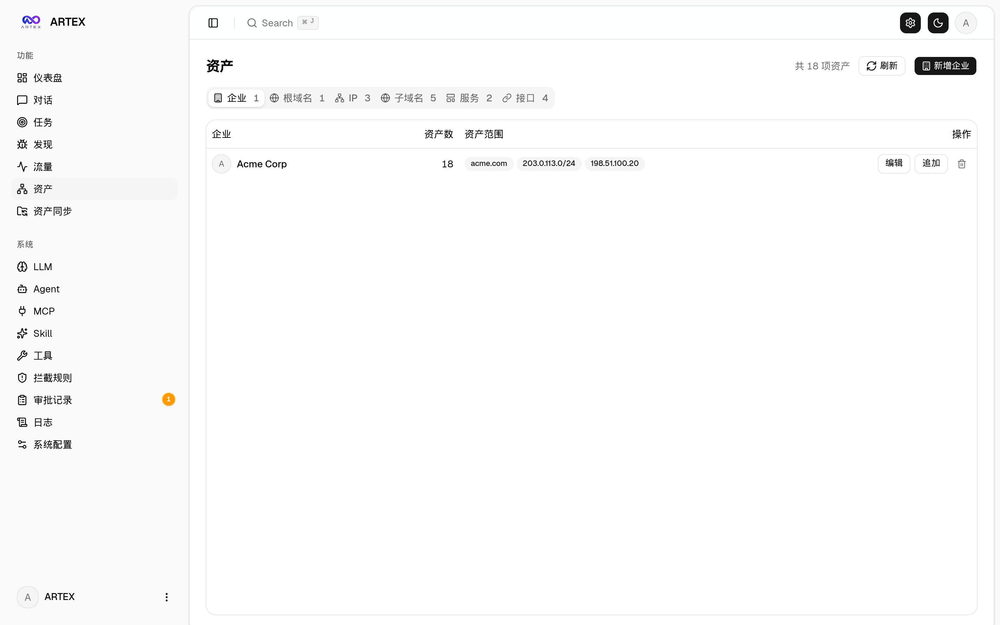
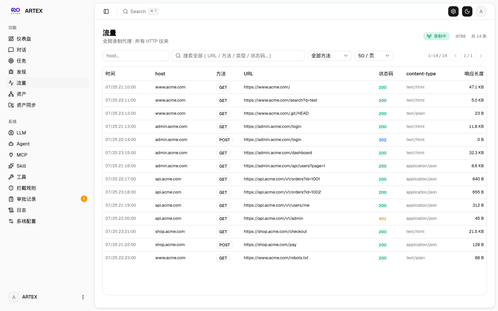
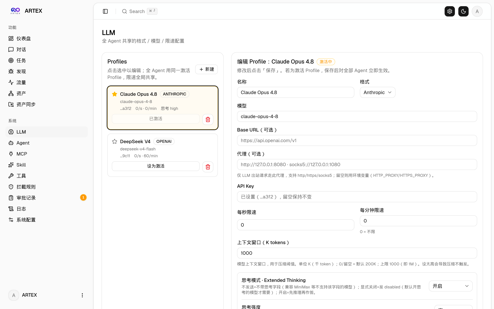
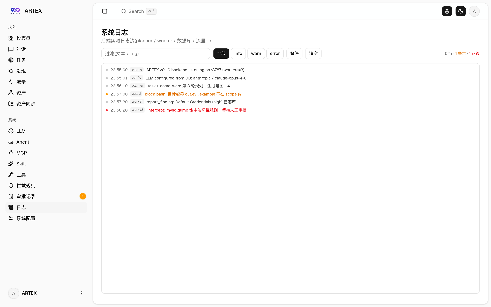
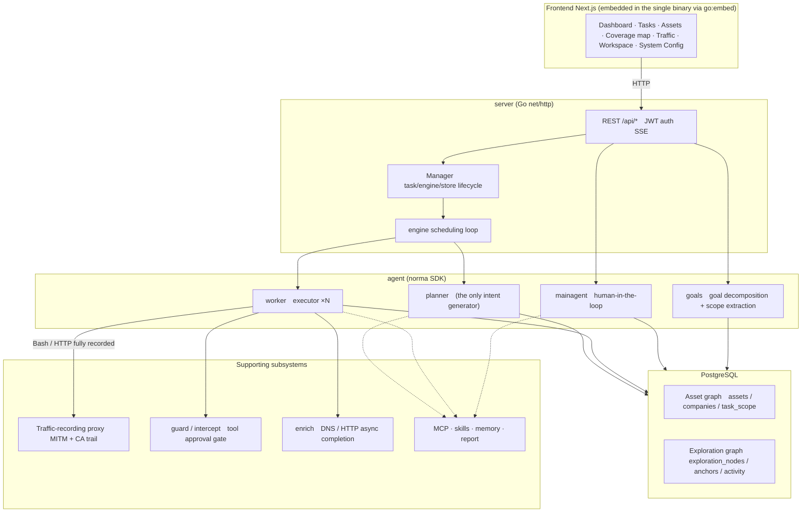
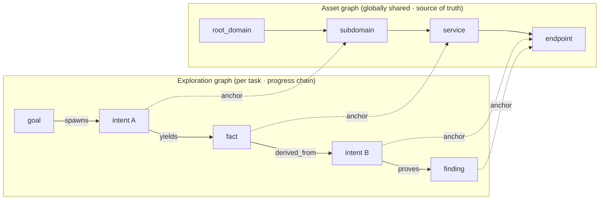
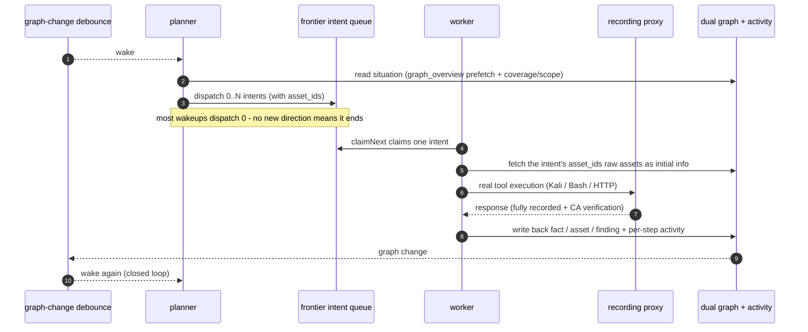
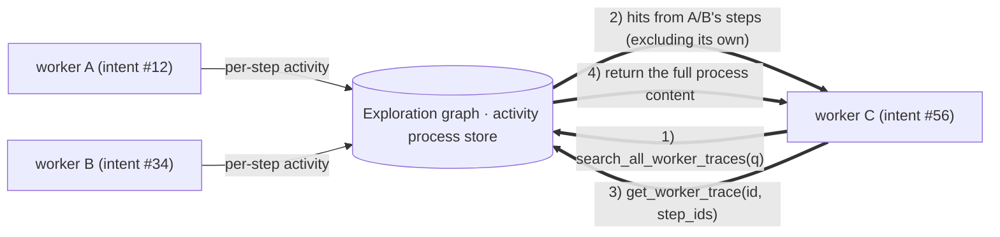
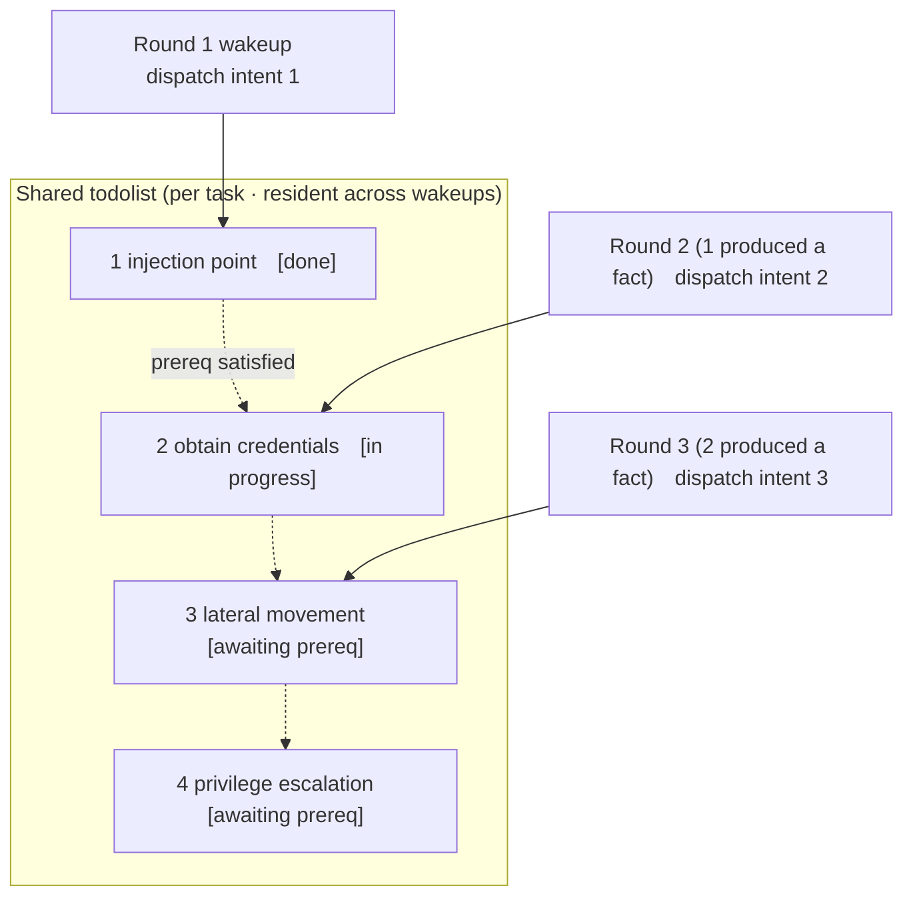

<div align="center">

# ARTEX

> **Archived upstream README.** This describes the upstream project and its
> prebuilt-image deployment. Do not follow its Docker or installer instructions
> in this fork. Use [`README.md`](README.md) instead.

AI autonomous penetration testing system (Go backend + Next.js frontend)


🌐 **Live demo**: [https://artex-demo.vercel.app/](https://artex-demo.vercel.app/)

</div>

This repository is an independently maintained fork of [RuoJi6/ARTEX](https://github.com/RuoJi6/ARTEX), preserving ARTEX's original commit history and AGPL-3.0 license. Release packages are downloaded from this repository's Releases, and the Docker image [ruoji6/artex](https://hub.docker.com/r/ruoji6/artex) is built and published by this repository's GitHub Actions.

---

## Screenshot preview

> For the full interaction, see the [live demo](https://artex-demo.vercel.app/).

| Dashboard (overview / token usage / activity stream) | Task list |
| :---: | :---: |
|  |  |

| Task - execution process (sessions / tool calls) | Exploration chain |
| :---: | :---: |
|  |  |

| Findings | Assets |
| :---: | :---: |
|  |  |

| Asset coverage map (force-directed layout - tested highlighted - collapse/expand nodes) |
| :---: |
|  |

| Traffic recording | Human-in-the-loop conversation |
| :---: | :---: |
|  |  |

| Agent management | LLM configuration |
| :---: | :---: |
|  |  |

| Intercept approval | Backend logs |
| :---: | :---: |
|  |  |


---

## Approval record details

The global "Approval Records", the per-task "Intercept Approvals", and the approval cards in conversations all support expanding to view details. The display structure follows
[AegisHook's approval-detail component](https://github.com/RuoJi6/AegisHook/blob/main/web/src/components/CallDetail.vue), reusing ARTEX's components and theme:


## Asset sync (ScopeSentry)

Supports syncing asset data directly from [ScopeSentry](https://github.com/Autumn-27/ScopeSentry), avoiding repeated collection:

- On the "**Asset Sync**" page, enter ScopeSentry's address and API Key to connect the data source;
- Select the targets and asset types to sync by **project** or **task** dimension (domain / subdomain / IP / port / site / endpoint...);
- Import in one click and merge by company asset scope, feeding directly into ARTEX's asset graph for agent exploration.

---

## Installation

> Requires the **PostgreSQL** database; exploration requires an **LLM** configured (`ANTHROPIC_API_KEY` or `OPENAI_API_KEY`, which can also be set in the UI).

### Option 1: one-click install script (recommended)

```bash
git clone https://github.com/RuoJi6/ARTEX.git
cd ARTEX
./install.sh
```

The script will: detect / auto-install Docker -> let you choose **(1) all Docker** or **(2) local build and run**:

- **(1) all Docker**: enter a Postgres password (press Enter for a random one) -> auto-write `.env` -> `docker compose up -d`.
- **(2) local run**: choose a database (connect to an existing one / start one with Docker) -> generate `config.json` -> `go` builds the embedded single binary -> start.

Once installed, open **http://localhost:8787** (on first entry, go to `/setup` to set the admin password).

### Option 2: Docker Compose (manual)

```bash
git clone https://github.com/RuoJi6/ARTEX.git
cd ARTEX
cp .env.example .env          # fill in POSTGRES_PASSWORD, optional ANTHROPIC_API_KEY
docker compose up -d          # pull the ruoji6/artex image + postgres
# -> http://localhost:8787
```

The image already includes common tools (ripgrep/curl/vim/npm/nmap...); `./skills` and `./data` are persisted via bind mounts.

In `.env`, `ARTEX_IMAGE=ruoji6/artex` by default, and `ARTEX_TAG=latest` uses the latest image; it can also be pinned to `v0.3.15` (full image address `ruoji6/artex:v0.3.15`). The image supports `linux/amd64` and `linux/arm64`, and Docker automatically selects the architecture matching the host, so ARM64 Kali needs no self-compilation. For a first deployment, change `POSTGRES_PASSWORD`; running the service needs no Docker Hub publishing token.

Remote MCP can be configured in System Settings as `http` (Streamable HTTP) or `sse` (legacy SSE).
A legacy SSE service typically uses `GET /sse` to establish the event stream, then receives JSON-RPC
requests via the `/message?sessionId=...` the service returns; when configuring, set the URL to `/sse` and fill the header as
`Authorization=Bearer <token>`.

### Option 3: download a prebuilt binary (Releases)

Go to this repository's [Releases](https://github.com/RuoJi6/ARTEX/releases) and download the zip for your platform; after extraction you get `artex` + `start.sh` (`start.bat` on Windows) + `skills/` + `config.example.json`. For Linux ARM64 (including ARM64 Kali) choose `linux-arm64`, and for x86_64 choose `linux-amd64`:

```bash
cp config.example.json config.json   # fill in the database connection
./start.sh                           # -> http://localhost:8787
```

> Start with `start.sh` / `start.bat`, not by running `./artex` directly. It is a supervisor script: after the program exits, it decides whether to relaunch based on the exit code, and **the UI's [one-click update](#option-1-one-click-update-from-the-ui-recommended) relies on it to perform the binary swap**. If you run `./artex` directly, it won't be relaunched after an update.
> Run resident in the background: `nohup ./start.sh >artex.log 2>&1 &`.

### Option 4: build a single binary from source

```bash
# 1) static export of the frontend
cd web && npm ci && npm run build:static && cd ..
# 2) copy into the embed directory
cp -r web/out server/webui/dist
# 3) build (-tags embedui is required to embed the frontend)
CGO_ENABLED=0 go build -tags embedui -o artex ./cmd/artex
./start.sh
```

### Option 5: build cross-platform release archives

`build.sh` first builds and embeds the frontend, then uses the Go linker to strip debug info and compresses the release files into zips. Release mode generates zips for Linux amd64/arm64, macOS amd64/arm64, and Windows amd64 by default:

```bash
./build.sh --release
# output: dist/artex-0.3.3-*.zip
```

UPX self-extracting binaries may be incompatible with some Linux kernels, virtualization environments, or security policies, so they are disabled by default. Use `ARTEX_TARGETS` to customize targets; when you've confirmed the target runtime is compatible, you can pass `--upx` explicitly to shrink the binary further:

```bash
ARTEX_TARGETS=linux/amd64,windows/amd64 ./build.sh --release
./build.sh --target linux/amd64 --upx
```

---

## Updating and upgrading

> An upgrade only swaps the program, not the data: the Postgres data volume `pgdata`, `./data` (jwt.key / SQLite / etc.), and `./skills` are all preserved. **Database migrations need no manual steps** - `artex` idempotently re-runs `schema.sql` on every startup (including `ADD COLUMN` / `CREATE INDEX IF NOT EXISTS`), i.e. "restart is migrate." It is still recommended to back up `./data` and the database before upgrading.

### Option 1: one-click update from the UI (recommended)

On the **System Configuration** page (sidebar "System Configuration" -> `/system/settings`), the **Version and Updates** card lets you check and install new versions directly, without logging into the server.

The program built by this repository always checks for updates from the latest official GitHub Release of `RuoJi6/ARTEX`, skipping drafts and prereleases. Older official programs still point to the original author's repository, so the first switch must manually install the program built by this repository; afterwards, publishing a higher three-part version lets you upgrade from the UI. Pushing only main or a Git tag without publishing a Release produces no online-installable new version.

After clicking "Update": download the release package for the current platform -> compare against the Release's `SHA256SUMS` -> smoke-test the new binary with `-h` -> stage it as `artex.new` -> the program exits, and `start.sh` / `start.bat` relaunches it and completes the swap. The page waits for the new version to come online and then refreshes automatically.

- **A failure leaves no broken program**: if verification or the smoke test fails, the staged file is discarded and the current version keeps running; if a swapped-in new version fails to start 3 times in a row, it automatically rolls back to `artex.old` (the failed one is kept as `artex.failed` for investigation).
- **Rollback anytime**: the previous version is kept as `artex.old`, and the card has "Roll back to previous version". Note that the database schema is not rolled back.
- **An update interrupts running tasks** - an update is a restart, so do it when idle.
- **Dev builds get no updates**: disabled when the version is `dev` or a `git describe` with a suffix, to avoid an official release overwriting a locally debugged binary.
- **Under Docker, only the program is swapped, not the image**: the image's playwright / nmap and other toolchains are not upgraded along with it, and after `docker compose up -d` recreates the container it reverts to the version bundled in the image. To upgrade the image too, still use `docker compose pull artex && docker compose up -d artex`.
- When accessing GitHub requires a proxy, just configure the **global proxy** on the same page, and the update path will use it. Updates download only from GitHub domains and force HTTPS.

### Maintainers: publishing online updates via GitHub Actions

The release workflow is `.github/workflows/release.yml`. Pushing an official tag triggers a build; you can also go to Actions -> release -> Run workflow and enter an existing tag to re-run a failed release. The tag must be `vMAJOR.MINOR.PATCH`, for example the `v0.3.15` below; subsequent versions must be higher than what users are running.

```bash
git push origin main
git tag v0.3.15
git push origin v0.3.15
```

The workflow pins the commit corresponding to the tag, exports the frontend with Node.js 22, builds the five-platform programs with embedded frontend using the Go version specified in `go.mod`, and generates ZIPs and `SHA256SUMS`. The AMD64 and ARM64 images are built on native GitHub runners respectively, connecting to a temporary PostgreSQL to verify program startup, version, and embedded frontend; only after both architectures pass does it publish the multi-arch image's version tag and `latest`. After the image publishes successfully it uploads the complete ZIPs and checksum file, and finally makes the Release public. An already-public version cannot be overwritten; publish a new tag instead.

Maintainers must configure, under this repository's Settings -> Secrets and variables -> Actions, the variable `ARTEX_DOCKER_IMAGE` (Docker Hub username/image name) and the Secrets `DOCKERHUB_USERNAME` and `DOCKERHUB_TOKEN` (with image-push permission). Program packages are uploaded via GitHub's built-in `GITHUB_TOKEN`, and the image is pushed to Docker Hub via the above credentials. The credentials are used only for the workflow to log in, and are not written into source or the image. The image address is also recorded in `.env.example` and the Compose defaults.

### Migrating an existing Docker deployment to this repository's image

In the original deployment directory, back up `.env`, the Compose file, `data/`, and the PostgreSQL data, keeping the original database volume and skills mount. Set `.env`'s `ARTEX_IMAGE` to this repository's image address and `ARTEX_TAG` to the target version; if the old Compose still hardcodes the original author's image, you can create the following override file (merge the image config if an override file already exists):

```yaml
# docker-compose.override.yml
services:
  artex:
    image: ${ARTEX_IMAGE}:${ARTEX_TAG:-latest}
```

Then update only the application container:

```bash
docker compose pull artex
docker compose up -d --no-deps artex
curl --fail http://127.0.0.1:8787/api/health
docker compose logs --tail=50 artex
```

Keep using the original deployment directory and Compose project name to ensure `./data`, `./skills`, and the PostgreSQL data volume still point to the original data. After migrating, the program checks for online updates from `RuoJi6/ARTEX`; afterwards you can update the program from the UI or update the whole image with the commands above.

When first migrating an existing Docker deployment, extract the verified new ARM64 ZIP onto the host, back up the original program, then replace only `/app/artex` in the existing container. For example, if the existing container is named `artex-artex-1`:

```bash
# Run in the download directory; first verify the downloaded ZIP against SHA256SUMS, then extract.
sha256sum --ignore-missing --check SHA256SUMS
unzip artex-0.3.15-linux-arm64.zip
sudo docker stop artex-artex-1
sudo docker cp artex-artex-1:/app/artex ./artex-before-migration
sudo docker cp ./artex-0.3.15-linux-arm64/artex artex-artex-1:/app/artex
sudo docker start artex-artex-1
curl --fail http://127.0.0.1:8787/api/health
```

This preserves the existing database, data, and skills mounts. Log into the System Configuration page to check the update source and version. The program replaced inside the container is still part of the container's writable layer; deleting or recreating the container loses the replacement, so when you need to recreate, use an image that contains this repository's program. A program rollback does not roll back database migrations; back up the database and data before upgrading.

### Option 2: one-click update script

```bash
cd ARTEX
./update.sh
```

The script first optionally `git pull`s the latest code, then lets you choose **(1) Docker update** or **(2) local build update** (matching `install.sh`):

- **(1) Docker**: you can specify the target image tag (press Enter to reuse `.env`'s `ARTEX_TAG`, defaulting to `latest`) -> `docker compose pull` -> `docker compose up -d` (swapping in the new image and restarting migrates automatically).
- **(2) local**: rebuild the frontend static output -> recompile `./artex` (restart the process afterwards to take effect).

### Option 3: Docker Compose (manual)

```bash
cd ARTEX
git pull                       # update compose / scripts (optional)
# To pin a version: set ARTEX_TAG=v0.3.15 in .env; if unset, latest is used
docker compose pull artex
docker compose up -d artex     # swap in the new image and restart -> auto-migrate schema
docker image prune -f          # clean up old images (optional)
```

### Option 4: prebuilt binary (Releases)

Go to [Releases](https://github.com/RuoJi6/ARTEX/releases) and download the new version's zip; stop the old process, overwrite `artex` and `skills/` (keeping your `config.json` and `data/`), and restart:

```bash
cp -r <extracted dir>/skills ./ && cp <extracted dir>/artex ./
./start.sh
```

### Option 5: build from source

```bash
git pull
cd web && npm ci && npm run build:static && cd ..
cp -r web/out server/webui/dist
CGO_ENABLED=0 go build -tags embedui -o artex ./cmd/artex
# restart ./start.sh
```

---

## Configuration

**Database** (`config.json`, or override with the environment variable `ARTEX_PG_DSN`):

```json
{
  "database": {
    "host": "127.0.0.1", "port": 5432,
    "user": "artex", "password": "yourpass",
    "dbname": "artex", "sslmode": "disable"
  }
}
```

**LLM**: `export ANTHROPIC_API_KEY=sk-...` (or `OPENAI_API_KEY`), or fill it in on the UI's "LLM Configuration" page.
Optional: `ARTEX_LLM_PROVIDER` / `ARTEX_LLM_MODEL` / `ARTEX_LLM_BASE_URL` / `ARTEX_LLM_PROXY`.

**Concurrency**: the number of work agents per task is configured under "System Settings" (default 3).

**Common parameters**: `./start.sh -addr :8787 -proxy :8788` (`-addr` frontend+API, `-proxy` traffic-recording proxy). The startup script passes the parameters through to `artex` unchanged.

### Reverse-proxy deployment (HTTPS / expose only 443)

The frontend and the API/SSE are both served by the same backend port (default `:8787`), and the live activity stream uses the **same-origin** address by default, so **there is no need to configure `NEXT_PUBLIC_SSE_BASE`**; expose only 443 publicly and keep 8787 on the internal network.

SSE is a long-lived connection with continuous push, so the reverse proxy **must disable buffering**, otherwise the browser connects but receives no events (it shows the activity stream spinning forever). Nginx example:

```nginx
server {
    listen 443 ssl;
    server_name your.domain.com;
    # ssl_certificate / ssl_certificate_key ...

    location / {
        proxy_pass http://127.0.0.1:8787;
        proxy_set_header Host $host;
        proxy_set_header X-Forwarded-Proto $scheme;

        # SSE essentials: disable buffering, long timeout, HTTP/1.1
        proxy_buffering off;
        proxy_cache off;
        proxy_read_timeout 3600s;
        proxy_http_version 1.1;
        proxy_set_header Connection "";
    }
}
```

> Only when SSE needs a different origin from the page (e.g. a separate subdomain) should you set `NEXT_PUBLIC_SSE_BASE` at **build time** (this variable is baked into the static bundle during `next build`, so setting it at container runtime has no effect).

---


## Development

### Manual vulnerability retest

The "Retest" tab of the task detail lets you select this task's vulnerabilities page by page, view past conclusions and evidence, and manually start a retest. After starting, it keeps the current tab, shows a spinner and "Retesting"; once a fix is confirmed, it updates the vulnerability status in sync.

Click "Retest" in each row's action area of the vulnerability list, or click "Start Retest" in the "Vulnerability Retest" area of the vulnerability detail, fill in the optional fix version, test conditions, or constraints, and the system creates a standalone retest Agent session, keeping the current page after starting. The list's flat, group-by-task, and asset views all support this entry point; while a retest runs it shows a spinner and "Retesting", and when you need to view it, click into the corresponding session; afterwards it reverts to "Retest". A retest needs no restart of the original scan task; conclusions are "Still reproducible", "Fixed", or "Cannot confirm", and each conclusion, evidence, and session link is saved in the vulnerability detail.

On its first startup, the new backend seeds an editable "Vulnerability Retest" (`retester`) Agent, whose prompt, LLM, run budget, and tools can be configured in Agent management. It uses its bound LLM by default, falling back to the globally active profile when unbound. When a retest session completes successfully with a "Fixed" conclusion, the system automatically changes the vulnerability's disposition status to "Fixed"; in-progress, failed, stopped, or other conclusions keep the original status. The original evidence and report are always retained. You can also manually select "Fixed" from the status dropdown. When the same vulnerability is being retested, the existing session is reused; after a stop, failure, or service restart, it can be started again.

This version's history is viewed via the vulnerability detail and session; it is not yet included in vulnerability report exports or task archive packages, and traffic packages are not auto-associated. Demo mode generates only clearly labeled simulated records and does not request real targets.

### Local run and testing

```bash
./dev.sh    # backend (:8787) + traffic proxy (:8788) + frontend next dev (:5173) -> http://localhost:5173
```

- Backend: `go run ./cmd/artex` (without `-tags embedui`, the frontend is not embedded)
- Frontend: `cd web && npm run dev` (`/api` reverse-proxied to the backend, with hot reload)
- Tests: `go test ./...`
- Mock preview (no backend): `cd web && NEXT_PUBLIC_MOCK=1 npm run dev`

---

## System technical architecture

ARTEX is an **LLM multi-agent-driven autonomous penetration system**: a Go monolithic backend (with embedded Next.js frontend) + PostgreSQL, with agent capabilities provided by the [`norma`](https://github.com/Autumn-27/norma) SDK (`agentcore` / `tool` / `permission` / `harness` / `memory` / `transcript`). At its core is a **dual-graph architecture**, plus two autonomy mechanisms built around it: **process-level information exchange between workers** and **the planner's multi-round shared todolist for a stable attack chain**.

### Overall layering



| Layer | Responsibility |
| --- | --- |
| **Frontend** | Next.js static export, embedded into the single binary via `go:embed`; visualizes tasks/assets/exploration chains/coverage map, and human-in-the-loop conversation |
| **server** | `net/http` routing + JWT auth + SSE; `Manager` hosts the lifecycle of tasks, the engine, and DB stores |
| **engine** | one `plannerLoop` + N worker goroutines per task; intent claiming, timeout/pause/drain |
| **agent** | goals / planner / worker / mainagent, with `ToolSet` exposing the dual graph as LLM tools |
| **db** | Postgres persistence of the dual graph (pgx); the schema idempotently creates tables on every startup via `go:embed` |
| **Supporting** | recording MITM proxy, approval gate, async completion, MCP/skills/memory/report |

### Dual-graph architecture: exploration graph + asset graph

The system splits "**what the target is**" and "**how far it has been tested**" into two graphs that are mutually independent yet connected via anchors:

- **Asset Graph (globally shared)**: a single source-of-truth asset store shared across tasks. Nodes are `root_domain / subdomain / ip / service / app / endpoint`, belonging to companies; the domain->subdomain->service->endpoint parent-child relationships and dedup keys are all computed by the program, and the agent only submits raw information.
- **Exploration Graph (per task)**: a single task's "thinking and progress" process. Nodes are `goal / intent / fact / finding / hint`, connected via edges such as `spawns / derived_from / yields / proves` into a **lineage chain**, answering "which direction derived from which facts, and what it produced".
- **The two graphs connect via anchors**: `exploration_anchors(node_id, asset_id)` anchors intents/facts/findings onto concrete assets - so you can both see, from an "exploration direction", which assets it hit, and look up, from "a given asset", which intents tested it in this task and which facts they produced. This also supports **asset test coverage** and the **asset coverage map** (in-scope assets + tested highlighted).



> Division of labor: the **planner** reads the exploration graph's situation, judges the goal, and dispatches **intents** into the frontier only when there is an uncovered new direction; a **worker** claims **one intent**, executes with real tools, writes new assets/facts/findings back into both graphs, and then stops. The asset graph is shared fact; the exploration graph is each task's progress chain.

### Engine and intent lifecycle (one exploration's closed loop)

The engine is an **event-driven** closed loop: a change to the graph wakes the planner, the planner dispatches intents, a worker claims an intent, executes, and writes back, and the write-back triggers the next round - until the goal is proven (`prove_goal`).



### Process-level information exchange between workers

In a deep exploration, many valuable observations (some error, a response fragment, a hidden parameter) appear in one worker's **execution process** without necessarily being written up as a formal fact. To avoid duplicate work and let workers on a chain stand on each other's shoulders, workers can **search across work processes**:

- `search_all_worker_traces(q)`: keyword-search within **the execution process of this task's other work** (automatically excluding your own intent's steps), with hits carrying `intent_id`;
- `list_worker_traces` / `get_worker_trace(intent_id, step_ids=[...])`: first see which work has run, then fetch the full content of specific steps of some work for a detailed exchange.

This way, even when there is no corresponding fact in the exploration graph yet, a later worker can reuse others' in-process observations - **information flows between workers at the granularity of the "execution process"**, while the boundary stays the same (each worker still only does the one intent it claimed).



### Planner multi-round shared todolist -> stable attack chain

A real attack chain is often a **multi-step sequence with front-to-back dependencies** (e.g. find an injection point -> obtain credentials -> move laterally -> escalate privileges), and dispatching all of these in parallel at once only creates chaos. The planner therefore holds a **per-task, cross-wakeup shared planning todolist**:

- the planner is event-driven - a graph change wakes it, but **each wakeup is a brand-new session**; the shared todolist lets it **record** a serial exploitation chain **once** and then **dispatch intents step by step over subsequent rounds by dependency**, rather than expanding the whole chain up front in one round;
- each round it only dispatches an intent for the next step whose "prerequisite steps are done and the facts it depends on exist," and it updates the list as progress is made (marking steps that facts have satisfied as done).



So the attack chain still **progresses stably, without duplication or misordering** in an "event-driven + stateless session" environment - this is the key to ARTEX autonomously completing a multi-step exploitation chain.

---

## Community group

Scan to follow the WeChat official account **SecSentry**, then DM it in the account backend to join the group.

<div align="center">


</div>

---
## References

https://github.com/oritera/Cairn


## License and disclaimer

### Open-source license

This project is licensed under the **GNU Affero General Public License v3.0 (AGPL-3.0)**; the full terms are in the [LICENSE](LICENSE) file in the repository root.

This means anyone is free to use, modify, and distribute this project, but **derivative works must likewise be open-sourced under AGPL-3.0**; in particular, **if you modify this project and provide it to users over a network (e.g. deployed as an online service), you must also make the corresponding complete source code available to those users**.

> ⚠️ **Important**: The open-source license itself does not restrict how the software may be used. The "usage restrictions" and "disclaimer" below are additional agreements and a solemn declaration from the author to users; please be sure to follow them.

**ARTEX is for personal study, code research, and local technical validation only, and must not be used to launch actual testing against any online system or website.**

### Permitted use

- Only for **reading, studying, and researching this project's source code**, and technical-principle validation in a **locally isolated environment**;
- Applicable to personal study, academic research, code review, and other non-offensive uses.

### Prohibited

- **It is strictly forbidden to use this tool to launch scanning, probing, exploitation, or attacks against any website, online service, or networked system** (whether or not authorized, and whether or not it is your own asset);
- It is strictly forbidden to use this tool for any actual penetration testing, red-team/blue-team exercises, or production environments;
- It is strictly forbidden to use this tool for illegal intrusion, data theft, extortion, denial of service, or any destructive or criminal activity;
- It is strictly forbidden to use this tool to engage in acts that violate the laws and regulations of your country/region.

### Compliance responsibility

Users must comply with all laws and regulations of their country/region regarding cybersecurity, data protection, and computer crime (in mainland China these include, but are not limited to, the Cybersecurity Law, the Data Security Law, the Personal Information Protection Law, and related judicial interpretations). **All legal responsibility and consequences arising from the use of this tool rest with the user.**

### Disclaimer

This project is provided "AS IS", without any warranty, express or implied. The author and contributors are not liable for any direct or indirect loss, data loss, system damage, or legal dispute caused by the use of this tool (whether used appropriately or not). **By downloading, installing, or using this project, you acknowledge that you have read, understood, and agreed to all of the above terms.**
