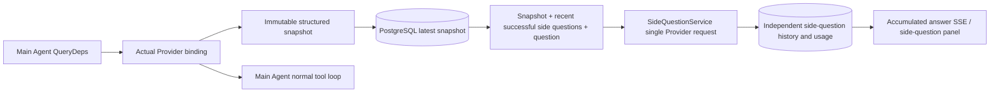

# ARTEX `/btw`

Ordinary chat, the task MainAgent, and the current task's own Worker all support standalone side questions. Submit by typing `/btw question` in the main input box; an empty `/btw` or the "side question" button opens the history. The desktop uses a width-adjustable sidebar, and mobile uses a Drawer.

Side-question answers are generated from the Agent context snapshot taken at submission time, with support for streaming display, follow-ups, stop, and clear. Closing the panel, refreshing the page, or dropping the SSE connection does not cancel the model request. Stop affects only the current side question; clear cancels the side question and deletes the side-question history while preserving the main context snapshot.

## Implementation boundaries

Reuses Go, norma v0.3.7, Next.js, and the existing Markdown / ResizablePanel / Drawer / AlertDialog components; the norma source was not modified and no dependencies were added for side questions. The Planner, Workers inherited from other tasks, and tool-type subtask escalation are out of scope for this change.

- `capture.go` only marks main-loop requests in `Options.Deps.CallModel / CallModelSync`. The Provider decorator sits inside the concrete model and outside the routing-pool selection, so it records the model that was actually selected; compaction and summary requests do not overwrite the snapshot.
- Snapshots are published on request start, the complete model reply, and the run's terminal state. A half-finished reply still being generated is not published; tool calls stay paired through norma's `MessagesForAPI`, and tool results enter the snapshot on the next main-model request or at the run's terminal state. Aborting a stream keeps the last valid boundary.
- The snapshot preserves structured messages, system prompts, tool definitions, and generation parameters via a JSON deep copy. Model inference holds no snapshot lock or database transaction.
- `SideQuestionService` calls the concrete Provider; it generates a side-question summary first when needed, and the final answer is allowed one retry after reduction only on the first context overflow and only when no text/tool call has been emitted yet. It creates no agent session and does not connect to the tool executor, main transcript, activity stream, or task graph, nor does it go through the task model switching chain. The answer retains tool definitions for compatibility with the existing structured tool context; summary requests provide no tools. Newly returned tool calls have no execution path.
- One running request per parent session, at most four per service process, with a 120-second timeout per request. Side questions use an independent cancel context under the service lifecycle.
- Side-question requests retain a model configuration reference and a non-sensitive identity summary; credentials are fetched from the existing configuration at request time. If the configuration is deleted, or identity fields such as the model, protocol, or address change, the main Agent must be run first to refresh the snapshot. Tests do not change the product default model.

## Persistence and recovery

`db/schema.sql` automatically creates `side_question_sessions` and `side_question_requests`. The former stores the parent resource, latest snapshot, run number, version, and cleanup version; the latter stores the question, accumulated answer, status, model, snapshot time, usage, event sequence number, and pagination sequence number.

The parent session key uses the conversation ID, or the task ID + exploration ID + intent ID. Workers do not use reusable execution-slot naming.

Snapshots are merge-written per parent session, flushed every 250 ms, with the database comparing `(run_id, version)` to prevent an older version from overwriting a newer one. The selected snapshot is saved again before the side question is submitted. Large in-memory snapshots are released after a successful save; on failure the pending version is retained. Accumulated answer content is written at most every 250 ms as streaming events arrive, and the terminal state is saved immediately with limited retries on database errors.

On service startup, leftover `running` requests are marked `interrupted`, preserving the partial answer and usage already persisted, without replaying the request automatically. The most recently saved context can be used directly for the next question. When an old session has no snapshot, the main Agent must be run first; the context is not rebuilt from the UI activity log.

The clear operation increments the cleanup version and deletes requests; a conditional update blocks late callbacks from writing back again. Physical deletion of a parent resource relies on foreign-key cascade, a Worker logical delete removes side-question data in the same transaction and rejects subsequent late snapshots. Task archiving first blocks new requests, waits for the main flow to stop, then cancels and waits for side questions to be persisted; the archive format is v3 and remains compatible with v1/v2, which lack the side-question tables.

History is stored in full and returns at most 20 items per page by sequence-number cursor. A model request replays the verbatim text of at most the 20 most recent successful question-answer pairs, while also limiting the replay volume by token budget; older pairs are kept in an independent rolling summary. When the main context exceeds budget, only the older part of the side-question copy is summarized, preserving recent structured tool calls and results. Summarization, preparation progress, and usage are all subject to the side question's concurrency, cancellation, and 120-second timeout limits. See [Context budget and open-source references](CONTEXT_BUDGET.md).

## HTTP contract

The following paths serve as `{parent}`, reusing the existing authentication and resource validation:

- `/api/conversations/{id}`
- `/api/tasks/{id}/chat`
- `/api/tasks/{id}/intents/{iid}`

| Request | Response and behavior |
| --- | --- |
| `GET {parent}/side-questions?before={ordinal}` | `items` ordered newest to oldest, an independent `current` run status, `snapshot` metadata, and `next_cursor`; a cursor of 0 means the latest page / no next page |
| `POST {parent}/side-questions` | JSON `{ "question": "…", "client_request_id": "UUID" }`; a new request returns 202 and the request object; the same ID and question return the existing object with 200 |
| `DELETE {parent}/side-questions` | Cancel and clear the side questions of the current parent session |
| `GET /api/side-questions/{requestID}/events` | `snapshot` SSE events, with `id` as an increasing sequence number and `data` as the complete accumulated request object; sends `cleared` on clear |
| `POST /api/side-questions/{requestID}/cancel` | Explicit cancel; the terminal state can be read from history or SSE |

The question limit is 4000 characters. No snapshot, a model configuration change, the same parent session being busy, or an idempotent ID conflict return 409; the global concurrency limit returns 429. Every SSE connection sends the accumulated state first and does not depend on text fragments the client received earlier. The frontend merges by request ID + sequence number and discards stale callbacks when switching parent sessions or on clear.

## Validation and references

Automated checks, real model usage, and known limitations are described in [VALIDATION.md](VALIDATION.md).

For the standalone request, see [Grok CLI side-question.ts (pinned commit)](https://github.com/superagent-ai/grok-cli/blob/fb97af83f06dca873281d60168430f06c8de6324/src/utils/side-question.ts), and for run isolation see [OpenCode (pinned commit)](https://github.com/anomalyco/opencode/tree/b3f1a96c6dd7adeb28b36dd11add1998fc84d67b). ARTEX's context uses norma's structured messages and does not adopt the approach of concatenating text from frontend logs.
