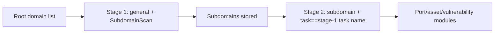

---

## name: scopesentry-mcp
description: Manage the security scanning platform (projects, tasks, templates, assets, nodes) through the ScopeSentry MCP. Use when the user mentions ScopeSentry, MCP, API Key, scan tasks, or asset queries.

# ScopeSentry MCP usage guide

For users with an **already-deployed ScopeSentry instance**. Connect to the platform through Cursor (or another MCP client); no local source code is needed.

## 1. Preparation

### 1.1 Confirm the service is reachable

- Default Web UI: `http://<host>`
- MCP endpoint: `http://<host>/mcp` (if there is a reverse proxy or frontend proxy in front, use the actual `/mcp` address)

### 1.2 Create an API Key

1. Log in to the ScopeSentry Web UI in a browser
2. Go to the **API Key** management page and create a key (or create one through an admin-provided endpoint)
3. Save the returned `ssk_...` string (**shown only once**)

### 1.3 Configure Cursor MCP

Cursor -> Settings -> MCP -> add a server:

```json
{
  "mcpServers": {
    "scopesentry": {
      "url": "http://<your-host>:8082/mcp",
      "headers": {
        "X-API-Key": "ssk_your_key"
      }
    }
  }
}
```

You can also use: `Authorization: Bearer ssk_your_key`

After configuring, restart the MCP or reload Cursor, and confirm that tools like `list_projects` and `list_assets` appear in the tool list.

---

## 2. Tool overview


| Tool                   | Purpose             |
| ---------------------- | ----------------- |
| `list_projects`        | Project tree grouped by tag (includes project IDs) |
| `list_projects_data`   | Paginated project list, searchable by name     |
| `get_project`          | Project details              |
| `create_project`       | Create a project              |
| `list_tasks`           | Scan task list            |
| `get_task`             | Task details              |
| `list_scan_templates`  | Scan template list            |
| `get_scan_template`    | Template details              |
| `list_plugin_modules`  | Scan pipeline module names          |
| `list_plugins`         | Available plugins (includes hash, default parameters) |
| `create_scan_template` | Create a scan template            |
| `create_scan_task`     | Create a scan task            |
| `list_assets`          | Query assets of all kinds (paginated list)       |
| `count_assets`         | Count assets (`/api/assets/common/total`) |
| `get_asset_detail`     | Asset or vulnerability details           |
| `add_asset_tag`        | Add a tag to an asset           |
| `list_nodes`           | Scan node list            |


Each tool's parameters follow the MCP tool description (schema); the search and filter syntax of `list_assets` / `count_assets` is identical, so read the `list_assets` description before querying assets.

When you need to know "how many in total", use `count_assets` (which maps to the Web pagination total endpoint) rather than paging through `list_assets` repeatedly just to count.

---

## 3. Common workflows

### 3.1 Query assets by project

When the user or context **already has a project criterion**, prefer adding `filter.project` to narrow the scope and avoid slow responses from too much cross-project data. If no project is specified, there is no need to force a project filter.

1. `list_projects` or `list_projects_data` to get the target project's **ObjectID** (`id` / `children[].value`)
2. `list_assets` with `filter.project` (**must be the ID, not the project's name**)

```json
{
  "asset_type": "asset",
  "pageIndex": 1,
  "pageSize": 20,
  "search": "domain=^example.com",
  "filter": {
    "project": ["<project ObjectID>"]
  }
}
```

### 3.2 Create a scan task

1. `list_nodes` to get online node names
2. `list_scan_templates` or `create_scan_template` to get a template **ObjectID**
3. `create_scan_task`: `name` and `node` are required, `template` takes the template ID (not the template name)

**Target source `targetSource` (same as the Web UI):**

| targetSource | Description | Required parameters |
| --- | --- | --- |
| `general` | Enter targets directly | `target` |
| `project` | Read targets from a project | `project` (array of project ObjectIDs) |
| `asset` | Search from the Web asset store | `search`; optional `project`, `filter`, `targetNumber` |
| `RootDomain` | Search from the root-domain store | `search`; optional `project`, `filter`, `targetNumber` |
| `subdomain` | Search from the subdomain store | `search`; optional `project`, `filter`, `targetNumber` |
| `UrlScan` | Search from URL scan results | `search`; optional `project`, `filter`, `targetNumber` |
| `*Source` (e.g. `subdomainSource`) | Create from "selected/searched" on an asset page | with `targetTp=search` use `search`; with `targetTp=select` use `targetIds` |

**Example - scan root domains directly:**

```json
{
  "name": "example-subdomain-collection",
  "node": ["node-1"],
  "template": "<template ObjectID>",
  "targetSource": "general",
  "target": "example.com\nfoo.com",
  "project": ["<project ObjectID>"]
}
```

**Example - continue scanning from the subdomain store (filtered by the previous task name):**

```json
{
  "name": "example-ports-and-vulns",
  "node": ["node-1"],
  "template": "<follow-up-module template ObjectID>",
  "targetSource": "subdomain",
  "search": "task==\"example-subdomain-collection\"",
  "project": ["<project ObjectID>"]
}
```

### 3.3 Full information gathering for a root domain (two-stage recommended)

When the input is a **root domain** and you need **full information gathering**, scan in two passes rather than running the whole pipeline at once.

**Reason:** distributed tasks are dispatched per **individual target**. When a root domain is the target, the node assigned that root domain will also run the follow-up modules on the subdomains it discovered on that same node, which tends to cause uneven load, slow speed, and errors.

**Best practice:**

1. **Stage one - subdomain collection only**
   - `targetSource`: `general`
   - `target`: all root domains (multiple lines)
   - Template: enable only `SubdomainScan` and `SubdomainSecurity` (subdomain scanning + subdomain takeover)
   - Use `get_task` to wait for the task to finish

2. **Stage two - follow-up modules**
   - `targetSource`: `subdomain`
   - `search`: `task=="<stage-one task name>"` (exact match on the task name)
   - Optional `project` to narrow the scope
   - Template: port scanning, asset mapping, vulnerability scanning, etc. (need not include SubdomainScan)
   - Subdomains are dispatched as independent targets across nodes, giving higher parallel efficiency

You can also, on the Web UI "Subdomain" asset page, filter by task name and then use "Create task from subdomains" for the same effect.



### 3.4 Create a scan template

1. `list_plugin_modules` -> list of module names
2. `list_plugins` (filterable by `module`) -> each plugin's `hash` and default `parameter`
3. `create_scan_template`: use `modules` to specify "module -> array of plugin hashes"

---

## 4. Asset queries (`list_assets` / `count_assets`)

`count_assets` uses the same `asset_type`, `search`, and `filter` as `list_assets` and returns `{ "total": N }`, corresponding to the Web endpoint `/api/assets/common/total`.

```json
{
  "asset_type": "subdomain",
  "search": "task==\"some-task-name\"",
  "filter": {"project": ["<project ObjectID>"]}
}
```

**Performance tips (apply to both `list_assets` and `count_assets`):** when a project criterion exists, prefer `filter.project` to narrow the scope; in `search`, use `==` exact match or `^` prefix match on indexed fields where possible (see [4.3](#43-search-search-expressions)), to avoid broad `=` fuzzy queries slowing the response. When there is no project context, do not force a project filter.

See the table in [4.4](#44-filter-exact-filtering) for the types that support `filter.project`.

### 4.1 Asset type `asset_type`

`asset`, `RootDomain`, `subdomain`, `app`, `mp`, `UrlScan`, `SensitiveResult`, `DirScanResult`, `crawler`, `vulnerability`, `PageMonitoring`, `IPAsset`, `SubdomainTakerResult`

Alias examples: `web`->asset, `vuln`->vulnerability, `ip`->IPAsset, `url`->UrlScan

### 4.2 Parameters


| Parameter                | Description                                   |
| ------------------------ | --------------------------------------- |
| `pageIndex` / `pageSize` | Pagination, default 1 / 20                            |
| `search`                 | Search expression (see next section)                              |
| `filter`                 | Exact-filter JSON (see next section)                          |
| `sort`                   | Only UrlScan and DirScanResult support sorting by `length` |
| `sid`                    | SensitiveResult only: the sensitive-rule name                |


`search` and `filter` **can be used together**.

### 4.3 search search expressions

A custom DSL (**not SQL**):


| Operator  | Meaning   | Index | Example                          |
| ---- | ---- | ---- | --------------------------- |
| `=`  | Fuzzy match (regex) | not indexed | `domain=example`            |
| `==` | Exact match (equals) | **uses index** | `port==443`                 |
| `!=` | Exclude   | — | `port!="80"`                |
| `&&` | AND    | — | `domain==example.com && port==443` |
| `||` | OR    | — | `title=admin || body=login` |


**Indexes and operators:** fields such as `domain`, `ip`, `port`, `title` are indexed, but only **`==` equals** or a **prefix match whose value starts with `^`** (e.g. `domain=^example.com`) can use the index; **`=` is turned into a regex fuzzy match and cannot use the index**, which tends to slow down with large data volumes.

**search fields common to all types:** `tag`, `task` (task name), `rootDomain`

**project cannot be written in search** (it is invalid, or errors when combined with `&&`). To filter by project, use `filter.project`.

**Common search fields per type:**


| asset_type           | Fields                                                                                  |
| -------------------- | ----------------------------------------------------------------------------------- |
| asset                | domain, ip, port, service, app, title, statuscode, icon, banner, type, body, header |
| RootDomain           | domain, icp, company                                                                |
| subdomain            | domain, ip, type, value                                                             |
| app                  | name, icp, company, category, description, url, apk                                 |
| mp                   | name, icp, company, category, description, url                                      |
| UrlScan              | url, input, source, resultId, type                                                  |
| SensitiveResult      | url, sname, body, info, md5                                                         |
| DirScanResult        | url, statuscode, redirect, length                                                   |
| vulnerability        | url, vulname, matched, request, response, level                                     |
| crawler              | url, method, body, resultId                                                         |
| PageMonitoring       | url, hash, diff, response                                                           |
| IPAsset              | ip, domain, port, service, webServer, app                                           |
| SubdomainTakerResult | domain, value, type, response                                                       |


**search examples:**

- `domain==www.example.com && port==443` (exact, uses index)
- `domain=^example.com` (prefix match, uses index)
- `ip==192.168.1.1`
- `task=="some-task-name"`
- `level==high` (vulnerability)
- `statuscode==200` (DirScanResult)

When a fuzzy contains is needed, use `=`, e.g. `title=admin` (not indexed, best combined with project or other criteria to narrow the scope).

### 4.4 filter exact filtering

A JSON object: multiple values under the same key are **OR**, different keys are **AND**.

**Prefer `project` when a project criterion exists:** if the user or context has specified a project and the asset_type supports `project`, include it to narrow the scope; do not force it when there is no project information.


| filter key   | Meaning       | Value notes                                                     |
| ------------ | -------- | -------------------------------------------------------- |
| `project`    | Owning project     | **ObjectID**, obtained via `list_projects` / `list_projects_data` |
| `task`       | Source task     | **Task name**, from the `name` of `list_tasks`                         |
| `port`       | Port       | e.g. `"443"`                                                |
| `service`    | Service/protocol    | e.g. `"https"`                                              |
| `app`        | Application fingerprint     | e.g. `"Nginx"`                                              |
| `icon`       | Icon hash  |                                                          |
| `statuscode` | HTTP status code | mainly for asset                                               |
| `status`     | Status       | UrlScan/DirScan HTTP code; vulnerability/sensitive-info handling status                       |
| `level`      | Vulnerability severity     | critical / high / medium / low / info                    |
| `type`       | Type       | e.g. subdomain record type A, CNAME                                         |
| `color`      | Sensitive-rule color   | SensitiveResult                                          |
| `sname`      | Sensitive-rule name    | SensitiveResult                                          |
| `tags`       | Tags       |                                                          |


**Available filter keys per type:**


| asset_type                            | filter key                                                      |
| ------------------------------------- | --------------------------------------------------------------- |
| asset                                 | project, port, service, app, icon, statuscode, type, task, tags |
| RootDomain                            | project, tags                                                   |
| subdomain                             | project, type, task, tags                                       |
| app / mp                              | project, tags                                                   |
| UrlScan                               | status, tags                                                    |
| DirScanResult                         | status, tags                                                    |
| SensitiveResult                       | status, color, sname, tags                                      |
| crawler                               | project, task, tags                                             |
| vulnerability                         | project, level, status, task, tags                              |
| PageMonitoring / SubdomainTakerResult | tags                                                            |
| IPAsset                               | project, port, service, app                                     |


**filter example:**

```json
{"project": ["<project ObjectID>"], "port": ["443"]}
```

**Combined query example:**

```json
{
  "asset_type": "asset",
  "search": "domain=^baidu && port==443",
  "filter": {"project": ["<project ObjectID>"]},
  "pageIndex": 1,
  "pageSize": 10
}
```

**Note:**

- When a project criterion exists, prefer `filter.project` (where supported); it need not be forced without project context
- Do not put the project's display name in `filter.project`
- Use `==` for known values and `^` for prefixes; avoid overusing `=` fuzzy match on large tables
- For UrlScan HTTP status use `filter.status`; for DirScanResult you can use `statuscode==200` in search
- For SensitiveResult by rule name: use `sname=rule-name` in `search`, or `filter.sname`

### 4.5 Sorting with sort

Supported only by **UrlScan** and **DirScanResult**:

```json
{"length": "ascending"}
```

Other types ignore `sort` and use the default sort by time.

---

## 5. Scan template module names

`TargetHandler`, `SubdomainScan`, `SubdomainSecurity`, `PortScanPreparation`, `PortScan`, `PortFingerprint`, `AssetMapping`, `AssetHandle`, `URLScan`, `WebCrawler`, `URLSecurity`, `DirScan`, `VulnerabilityScan`, `PassiveScan`

---

## 6. Troubleshooting


| Symptom        | Fix                                                 |
| --------- | -------------------------------------------------- |
| No tools in MCP   | Check the URL, API Key, and whether ScopeSentry is running                    |
| 401 / 403 | Recreate or replace the API Key                                    |
| Assets not found     | Confirm `filter.project` is an ObjectID; do not put project in search |
| Template/task creation fails | `template` must be a template ObjectID; `node` takes online node names            |
| Queries slow/stuck   | With a project, add `filter.project`; in search switch indexed fields to `==` or `^` prefix, use `=` less; reduce `pageSize` |


---
